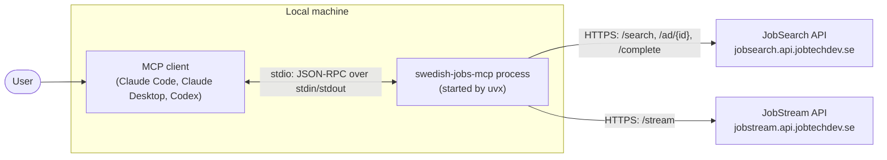

# swedish-jobs-mcp

[](https://github.com/kizouker/swedish-jobs-mcp/actions/workflows/ci.yml)

An MCP server that lets AI assistants (Claude, Codex, Cursor, …) search all
current job ads in Sweden — the ads in Arbetsförmedlingen's Platsbanken.

It talks to Arbetsförmedlingen's open JobTech APIs. It is not affiliated with
or endorsed by Arbetsförmedlingen.

mcp-name: io.github.kizouker/swedish-jobs-mcp

## Tools

| Tool | What it does |
|---|---|
| `search_jobs` | Free-text search ("python malmö"), remote filter, last N days, sorting, paging |
| `get_job` | One ad in full: description, salary, skills, apply link |
| `suggest_search_terms` | Autocomplete ("utve" → "utvecklare") |
| `changes_since` | Ads added/removed in all of Sweden in the last N hours |

## How it works

The MCP client starts the server as a local process and talks to it over stdio. The server then calls Arbetsförmedlingen's JobTech APIs over HTTPS. No port is opened on your machine.



## Install

Needs [uv](https://docs.astral.sh/uv/).

**Claude Desktop** — add to `claude_desktop_config.json`:

```json
{
  "mcpServers": {
    "swedish-jobs": {
      "command": "uvx",
      "args": ["swedish-jobs-mcp"],

    }
  }
}
```

**Claude Code:** `claude mcp add swedish-jobs -- uvx swedish-jobs-mcp`

**Codex** — add to `~/.codex/config.toml`:

```toml
[mcp_servers.swedish-jobs]
command = "uvx"
args = ["swedish-jobs-mcp"]
```


## Paging

`search_jobs` and `changes_since` return at most 25 ads per call, so one answer
never floods the AI's context. Each result has a `next_offset`: call the tool
again with `offset=next_offset` to get the next page. When `next_offset` is
`null`, there are no more ads.

## Configuration

Everything is optional. Set these as environment variables (in the `env` block
of your MCP client config) to change the defaults:

| Variable | Default | What it does |
|---|---|---|
| `SWEDISH_JOBS_MAX_PAGE_SIZE` | `25` | Most ads returned per call |
| `SWEDISH_JOBS_DEFAULT_PAGE_SIZE` | `25` | Ads returned when no `limit` is given |
| `SWEDISH_JOBS_TIMEOUT` | `30` | Seconds to wait for JobSearch |
| `SWEDISH_JOBS_STREAM_TIMEOUT` | `120` | Seconds to wait for JobStream |
| `JOBTECH_SEARCH_URL` / `JOBTECH_STREAM_URL` | JobTech's public URLs | Point at another host, e.g. a test server |

## Fair use

JobSearch is meant for searching, not bulk downloading. For a full copy of
all ads, JobTech points to the JobStream API instead. Job ad texts may
contain contact people's names and emails; don't store them longer than you need.

## Data

Job ads come from Arbetsförmedlingen's open JobSearch and JobStream APIs,
originally published under the name JobTech Development (JobTech). This
repository's MIT license covers only the code, not the data.

- **Licence:** Arbetsförmedlingen publishes the job ads under Creative Commons
  CC0 (public domain). No attribution is required, but we credit
  Arbetsförmedlingen / JobTech as the source. See the dataset page:
  <https://data.arbetsformedlingen.se/dataset/job-ads/>
- **Status:** The JobTech Development brand is being retired. Open
  data and APIs are moving to Arbetsförmedlingen's own site and to the data
  catalogue at <https://data.arbetsformedlingen.se/>. Read more in
  [Vad händer nu med Arbetsförmedlingens JobTech?](https://swedishjobtech.se/nyheter)
  (Swedish JobTech, 18 Oct 2024). The old `jobtechdev.se` pages may no longer
  work.
- **API key:** The old JobTech pages asked developers to apply for an API key.
  We looked for one and could not find it: the page that should issue it
  (`apirequest.jobtechdev.se`) was not working when we checked. The new
  catalogue says no key or registration is needed, and the server works
  without one today.
- **As-is:** We use the APIs as they are, for as long as they keep working. If
  the API addresses or terms change, set `JOBTECH_SEARCH_URL` and
  `JOBTECH_STREAM_URL` (see Configuration) and check the catalogue above.
- **Questions about the data:** opendata@arbetsformedlingen.se

## Development

```sh
uv run --extra dev pytest          # offline tests: unit tests + end-to-end over MCP (API is faked)
uv run --extra dev pytest -m live  # live tests against the real JobTech API
```

The end-to-end tests (`tests/test_e2e.py`) start the server as a real process
and call its tools over MCP, against a small fake JobTech server on localhost.

GitHub Actions runs the lint and the offline tests (Python 3.10-3.13) on every
push and pull request. The live tests run every Monday and can be started by hand
(Actions tab -> CI -> Run workflow), so a change in the JobTech API shows up as a
failed run without blocking pull requests.

### Try it locally with MCP Inspector

[MCP Inspector](https://github.com/modelcontextprotocol/inspector) is a web page where you can call the tools yourself. Needs Node.js.

```sh
npx @modelcontextprotocol/inspector uv run swedish-jobs-mcp
```

Open the address printed in the terminal, click **Connect**, then **Tools** → **List Tools**.

### Debug in VS Code

Start the server through Inspector with [debugpy](https://github.com/microsoft/debugpy) listening on port 5678:

```sh
npx @modelcontextprotocol/inspector uv run --with debugpy python -X frozen_modules=off -m debugpy --listen 127.0.0.1:5678 -m swedish_jobs_mcp.server
```

`.vscode/launch.json` already has an attach configuration:

```json
{
  "version": "0.2.0",
  "configurations": [
    {
      "name": "Attach to MCP server",
      "type": "debugpy",
      "request": "attach",
      "connect": { "host": "127.0.0.1", "port": 5678 },
      "justMyCode": false
    }
  ]
}
```

1. Set a breakpoint in `src/swedish_jobs_mcp/server.py`.
2. In Inspector, click **Connect**.
3. In VS Code, open **Run and Debug**, pick **Attach to MCP server** and press play.
4. In Inspector, run a tool (for example `search_jobs`). VS Code stops at the breakpoint.

Tips:

- Don't use `print()` in the server. It writes to stdout, which is the MCP channel, and breaks the connection. Use `logging` or write to stderr.
- `Address already in use` means an old process still holds port 5678. Find it with `lsof -i :5678` and stop it with `kill <PID>`.
- `-X frozen_modules=off` stops the debugger from missing breakpoints.

## License

MIT
